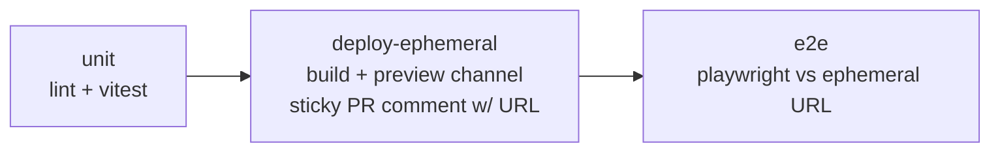
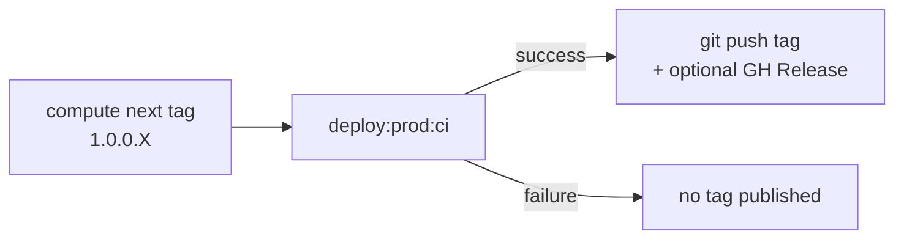

# Plan: Automated CI/CD Deployments (GitHub Actions)

Wire up GitHub Actions so that **every PR** runs unit tests, deploys to an
ephemeral Firebase **preview channel**, shows the preview link prominently on the
PR, and runs the e2e suite against it. **Merges to `main`** are gated on those
checks via a GitHub ruleset, and each merge **auto-tags `1.0.0.X`** and deploys
to production.

No tests exist yet, so this plan scaffolds **Vitest** (unit) and **Playwright**
(e2e) with real starter tests.

> Target branch: a feature branch off `main` (e.g. `actions`). Package manager on
> this branch is **Yarn** (Node 22). The Bun migration lives on a separate,
> unrelated branch and is intentionally ignored here.

---

## Requirements recap

- **Every PR**
  - Runs the unit test suite.
  - Deploys to an ephemeral environment via `deploy:ephemeral:ci` (plus
    `deploy:ephemeral` for local runs).
    - The preview link is shown somewhere prominent on the PR itself.
    - Integration + regression (e2e) suites run against that environment.
    - The e2e suite must run **either locally or through the ephemeral env**.
- **PR cannot merge to `main`** until tests pass, deployment succeeds, and the
  deployment test suite passes — enforced via a GitHub ruleset configured with
  the `gh` CLI.
- **On merge to `main`**, create an auto-incremented tag `${version from
package.json}.X` and deploy that tag to prod via `deploy:prod:ci`.
- Flag any **Firebase free (Spark) plan** billing concerns.

---

## Decisions (locked)

| Decision                  | Choice                                                                                       |
| ------------------------- | -------------------------------------------------------------------------------------------- |
| Repo visibility           | **Public** → unlimited GitHub Actions minutes                                                |
| Test frameworks           | **Vitest** (unit) + **Playwright** (e2e), scaffolded with starter tests                      |
| Integration vs regression | **One e2e suite** for now (no split)                                                         |
| Firebase CI auth          | **Service account** via `GOOGLE_APPLICATION_CREDENTIALS` (secret `FIREBASE_SERVICE_ACCOUNT`) |
| Toolchain                 | Yarn + Node 22 + `ubuntu-latest` runners                                                     |
| Ephemeral env             | Firebase Hosting **preview channel** named `pr-<number>`, `--expires 7d`                     |
| Prod tag ordering         | **Deploy first, push tag on success** (see below)                                            |

---

## Architecture

### PR pipeline (`on: pull_request` → `main`)

- No double build: `deploy-ephemeral` builds and deploys; `e2e` runs against the
  returned URL (no local server/build in CI).
- Per-PR concurrency cancels superseded runs to save time and Firebase quota.

### Prod pipeline (`on: push` → `main`)

---

## Phase 0 — Persist this plan

Create this document at `docs/feature-github-actions/PLAN.md` (done).

## Phase 1 — Test infrastructure

1. **Vitest** in a _separate_ `vitest.config.js` (not `vite.config.js`) so unit
   tests don't trigger the `optimize-images` / `mkcert` Vite plugins. Config:
   `jsdom` environment, `globals: true`, `setupFiles`.
2. `src/test/setup.js` — `@testing-library/jest-dom` matchers + a
   `window.matchMedia` mock (required by `useTheme`).
3. Starter unit tests:
   - `src/components/GitHubIcon.test.jsx` — pure leaf component; asserts the link
     renders with its accessible name and `href` (no Router/providers needed).
   - `scripts/next-prod-tag.test.js` — covers the pure tag-increment logic (no
     tags → `.0`, `max + 1`, ignores non-matching tags, handles gaps).
4. **Playwright** `playwright.config.js`:
   - `baseURL = process.env.E2E_BASE_URL || 'http://localhost:4173'`.
   - `webServer` (runs `vite preview`) is configured **only when `E2E_BASE_URL`
     is unset** → suite runs locally _or_ against the ephemeral URL.
   - Chromium only to start.
5. Starter e2e `e2e/smoke.spec.js`: visit `/`, assert the "Noah" and "PACIFIC"
   cards render, and navigate to `/noah` and `/pacific`.

## Phase 2 — Deploy scripts

6. `scripts/deploy-ephemeral.mjs` — builds, runs
   `firebase hosting:channel:deploy <CHANNEL_ID|branch> --json --expires 7d
   --project alvarado-dev`, parses the channel URL from the JSON result, prints
   it, and appends `url=<url>` to `$GITHUB_OUTPUT` when running in CI. Backs both
   `deploy:ephemeral` (local) and `deploy:ephemeral:ci`.
7. `deploy:prod:ci` → `vite build && firebase deploy --only hosting --project
   alvarado-dev --non-interactive`.
8. `scripts/next-prod-tag.mjs` — exports `computeNextTag(baseVersion,
   existingTags)`; a CLI reads `git tag -l` and prints the next tag. Reads the
   base version from `package.json` (`1.0.0`), finds the max existing `1.0.0.X`,
   returns the next (`.0` if none).
9. `package.json` updates:
   - Scripts: `test` (`vitest run`), `test:watch` (`vitest`), `test:e2e`
     (`playwright test`), `test:e2e:ci` (`playwright test`), `deploy:ephemeral`,
     `deploy:ephemeral:ci`, `deploy:prod:ci`. Existing `deploy:qa` / `deploy:prod`
     stay unchanged.
   - devDeps: `vitest`, `@testing-library/react`, `@testing-library/jest-dom`,
     `jsdom`, `@playwright/test`.

## Phase 3 — Workflows (`.github/workflows/`)

10. `pr.yml` (`on: pull_request` → `main`):
    - **unit**: install, `yarn lint`, `yarn test`.
    - **deploy-ephemeral** (`needs: unit`): write the service-account secret to a
      temp file, export `GOOGLE_APPLICATION_CREDENTIALS`, set
      `CHANNEL_ID=pr-${{ github.event.number }}`, run `yarn deploy:ephemeral:ci`,
      capture the URL as a job output, and post/update a **sticky PR comment**
      with the preview link. Requires `pull-requests: write`.
    - **e2e** (`needs: deploy-ephemeral`): `npx playwright install --with-deps
      chromium`, run `E2E_BASE_URL=<url> yarn test:e2e:ci`, upload the Playwright
      report artifact on failure.
    - Per-PR `concurrency` group with `cancel-in-progress: true`.
11. `deploy-prod.yml` (`on: push` → `main`) — see ordering below. Requires
    `contents: write` (push tag + optional Release).
12. `pr-cleanup.yml` (`on: pull_request: types: [closed]`): `firebase
    hosting:channel:delete pr-<number> --project alvarado-dev --force` to reclaim
    Spark storage.

### Prod deploy ordering — deploy first, tag on success

Compute the number up front, deploy, and **publish the tag only if the deploy
succeeds**:

1. `checkout` with `fetch-depth: 0` (need tags).
2. `BASE=$(node -p "require('./package.json').version")`; `MAX` from
   `git tag -l "$BASE.*"`; `NEXT = MAX + 1` (else `0`); `TAG=$BASE.$NEXT`
   (**compute only — do not push yet**).
3. Write the service-account secret; run `yarn deploy:prod:ci`.
4. **On success** → `git tag -a $TAG` + `git push origin $TAG` (+ optional GitHub
   Release). **On failure** → nothing is published.
5. `concurrency` group for prod with **`cancel-in-progress: false`** so runs
   serialize and tag numbering is race-safe.

**Rationale:** tags stay meaningful (every `1.0.0.X` == a real prod release),
failed deploys don't burn version numbers, retries are clean, and each tag is a
ready rollback target. This still honors "deploy _this_ tag" because the merge
commit on `main` is exactly what gets tagged.

## Phase 4 — Merge gate (`gh` CLI) + secrets

13. `scripts/branch-ruleset.json` + `scripts/setup-branch-ruleset.sh` — a
    one-time `gh api ... /rulesets` call that requires a PR before merging,
    requires the checks `unit`, `deploy-ephemeral`, and `e2e`, and blocks
    force-push / deletion on `main`.
14. `.gitignore` additions: `playwright-report/`, `test-results/`, `coverage/`,
    `*serviceaccount*.json`. Light README note documenting the new scripts, the
    required secret, and the one-time ruleset step.

---

## Files

### New

- `docs/feature-github-actions/PLAN.md`
- `.github/workflows/pr.yml`
- `.github/workflows/deploy-prod.yml`
- `.github/workflows/pr-cleanup.yml`
- `vitest.config.js`
- `src/test/setup.js`
- `src/components/GitHubIcon.test.jsx`
- `playwright.config.js`
- `e2e/smoke.spec.js`
- `scripts/deploy-ephemeral.mjs`
- `scripts/next-prod-tag.mjs`
- `scripts/next-prod-tag.test.js`
- `scripts/branch-ruleset.json`
- `scripts/setup-branch-ruleset.sh`

### Modified

- `package.json` — add scripts + devDeps (existing `deploy:qa` / `deploy:prod`
  and `deploy.sh` remain untouched).
- `.gitignore` — ignore test/report/coverage output and any local SA key.
- `README.md` — light usage note.

> `vite.config.js` is intentionally left as-is; Vitest gets its own config so the
> `execSync('node optimize-images.mjs')` `buildStart` plugin never runs during
> unit tests.

---

## CI authentication pattern

Both deploy workflows:

1. Write the `FIREBASE_SERVICE_ACCOUNT` secret to `"$RUNNER_TEMP/sa.json"`.
2. Export `GOOGLE_APPLICATION_CREDENTIALS="$RUNNER_TEMP/sa.json"`.
3. Run the deploy script with `--project alvarado-dev` (firebase-tools picks up
   the credentials non-interactively).

Permissions: `pr.yml` needs `pull-requests: write` (sticky comment);
`deploy-prod.yml` needs `contents: write` (tag push + Release).

---

## Secrets & provisioning

- **`FIREBASE_SERVICE_ACCOUNT`** — JSON key for a service account with the
  Firebase Hosting Admin role on project `alvarado-dev`. Easiest provisioning:
  run `firebase init hosting:github` once to mint the service account and add the
  repo secret, then keep these custom workflows (instead of the generated ones).
  Manual alternative: create the SA + key in the Google Cloud console and add the
  secret by hand.
- **`GITHUB_TOKEN`** — auto-provided; used for the sticky PR comment, tag push,
  and optional Release (governed by the per-workflow `permissions` above).

---

## Rollout order

1. Provision the `FIREBASE_SERVICE_ACCOUNT` secret.
2. Merge the feature branch → `main` so the workflows and their checks exist on
   `main`.
3. Run `scripts/setup-branch-ruleset.sh` (requires admin) to enforce the required
   checks on subsequent PRs.

---

## Verification

1. `yarn test` passes locally (`GitHubIcon` + tag-logic tests).
2. `yarn test:e2e` passes locally (auto-builds + `vite preview`).
3. `node scripts/deploy-ephemeral.mjs` prints a working preview URL (requires
   local Firebase auth).
4. Open a test PR → three checks run, the preview link appears as a PR comment,
   and e2e runs green against it.
5. Merge → `deploy-prod` deploys, then creates tag `1.0.0.0` and publishes live.
6. After the first merge, run the ruleset script; confirm a new PR shows the
   checks as **required**.

---

## Firebase free (Spark) plan — billing notes

- **No Blaze upgrade needed** — it's a static site; Hosting and preview channels
  are included on Spark.
- **Public repo ⇒ unlimited GitHub Actions minutes**, so Playwright runs and
  builds incur no Actions billing.
- **Watch on Spark:** 10 GB storage + **360 MB/day transfer**. The site is
  image-heavy, so each preview is a full `dist` copy (Firebase dedupes identical
  files by hash) and e2e loading images consumes daily transfer. Mitigations
  built into the plan: **7-day channel TTL**, **delete channel on PR close**, and
  keeping the e2e suite lean.
- **Service-account creation is free.** Note: fork PRs can't read repo secrets,
  so external-fork PRs would skip the deploy step — fine for a personal repo.

---

## Further considerations

1. **Provisioning the SA secret** — prefer `firebase init hosting:github` to mint
   the service account + secret, then keep these custom workflows (vs. manually
   creating a GCP key).
2. **Lint as a merge gate** — include `yarn lint` in the required checks (matches
   the existing pre-commit hook). Recommended.
3. **Browser coverage** — start Chromium-only for speed; add Firefox/WebKit later
   if broader coverage is wanted.
