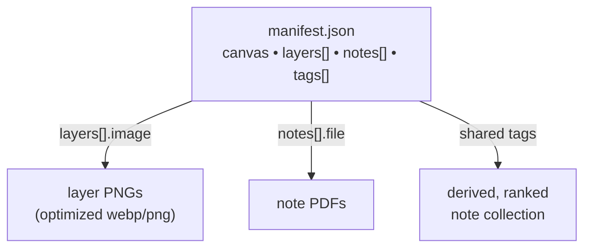

# Visually Layered Notes — Technical Architecture

> Companion to [PROJECT.md](./PROJECT.md) (what the app does) and [CONTENT.md](./CONTENT.md)
> (how to author content). This document describes the **shape of the data and resources**
> the viewer consumes and the **implications of that shape for how the application functions**.

## 1. Resources at a glance

A **composite** is defined entirely by content — no code changes are needed to add or edit one:

- **Composite manifest** — a runtime-fetched JSON file describing the composite's layers,
  notes, and tag vocabulary.
- **Layer images** — one transparent PNG per structure, all on a shared canvas, delivered
  through the site's optimized-image pipeline.
- **Note documents** — PDFs referenced by URL.
- **Tags** — plain strings shared between layers and notes; the sole link between artwork and
  notes.



## 2. Storage layout

Per composite `<id>` (first subject: `neck`):

```text
src/assets/jude/<id>/*.png       # source layer art (input to the image pipeline)
public/optimized/jude/<id>/*     # generated responsive variants consumed by the viewer
public/jude/<id>/manifest.json   # composite definition (fetched at runtime)
public/jude/<id>/notes/*.pdf     # note documents, served as-is
public/jude/composites.json      # data-driven index of composites ({ id, label })
```

The manifest is **runtime JSON** (not bundled) so content is decoupled from code and can be
edited without a rebuild. Composites are **data-driven**: the switcher reads the runtime
`public/jude/composites.json` index, and `useComposite` builds each manifest URL from the id
(`/jude/<id>/manifest.json`), so the route `/visually-layered-notes/:compositeId` resolves any
subject with no code change. See §9 for the authoring layer that writes these resources.

## 3. Manifest shape

```jsonc
{
  "id": "neck",
  "name": "Neck — Neuromuscular System",
  "canvas": { "width": 1200, "height": 1500 },
  "layers": [{ "id": "scm", "name": "Sternocleidomastoid", "image": "jude/neck/scm", "order": 60, "tags": ["muscle", "scm", "lateral-neck"] }],
  "notes": [{ "id": "scm-oi", "title": "SCM — Origin & Insertion", "file": "/jude/neck/notes/scm-oi.pdf", "tags": ["scm", "muscle"] }],
  "tags": ["muscle", "scm", "lateral-neck", "bone", "..."],
}
```

Each field and its functional role:

| Field            | Shape                                                    | Implication for the app                                                                        |
| ---------------- | -------------------------------------------------------- | ---------------------------------------------------------------------------------------------- |
| `canvas`         | intrinsic `{ width, height }` of the shared layer canvas | Sets the viewer's aspect ratio and the resolution of the hit-test map (§6).                    |
| `layers[].image` | base path under `/optimized/`                            | Selects the responsive webp/png variants to stack (§5).                                        |
| `layers[].order` | integer z-index                                          | Stacking order; higher renders nearer the viewer, and is the top-to-bottom order in the panel. |
| `layers[].tags`  | `string[]`                                               | Drives the structure's note collection and whether it "has notes" (§4).                        |
| `notes[].file`   | URL under `public/`                                      | The PDF rendered inline for that note.                                                         |
| `notes[].tags`   | `string[]`                                               | Matched against layer tags to build collections (§4).                                          |
| `tags`           | `string[]`                                               | The known vocabulary; populates the manual tag search.                                         |

## 4. Tag model and note derivation

Notes are **not** mapped directly to structures. A structure's collection is derived at runtime:

- **collection(layer)** = every note whose tags intersect the layer's tags, **ranked by the
  number of shared tags** (ties break by manifest order, then title).
- **hasNotes(layer)** = that collection is non-empty.

Implications for behavior:

- `hasNotes` decides the on-image click: **has notes → clicking opens the ranked collection;
  no notes → clicking hides the layer** to reveal what is behind it.
- The same ranking powers the manual tag search (any selected tag = union, ranked by overlap).
- Because matching is pure data, editing tags in the manifest changes behavior with no rebuild.

## 5. Layer image resources

- **Transparency is load-bearing:** only a layer's non-transparent pixels represent its
  structure. Layers are therefore delivered as **webp/png only** — the site's default jpg
  fallback would flatten alpha and is not used for layers.
- **Shared-canvas registration:** every layer PNG is exported at the same canvas size, so the
  responsive variants (all selecting the same width at a given viewport) stack in perfect
  alignment.
- **Pipeline:** source PNGs in `src/assets/jude/<id>/` are processed by `optimize-images.mjs`
  into `public/optimized/jude/<id>/` (400/800/1200/1920, webp/png/jpg); layers consume only the
  alpha-preserving formats.

Implication: the composite renders as absolutely-positioned, `order`-stacked images inside an
aspect-ratio box; hiding and isolating are just adding/removing layers from that stack.

## 6. Hit-testing: an implication of raster layers

Because structures are overlapping **raster** images, a DOM `` cannot report which
_visible_ structure is under a pointer — its bounding box includes transparent pixels. The app
therefore derives a low-resolution **pick map** from the layers' alpha:

- Visible layers are drawn bottom→top into an offscreen canvas sized from `canvas`; each pixel
  stores the topmost structure's index. Same-origin images keep the canvas untainted.
- A pointer event reads a single pixel to resolve the structure for hover/selection; the map is
  rebuilt only when visibility or isolation changes.

This is a direct consequence of the resource shape (raster, transparent, stacked). It is also
why the layer panel exists as the keyboard-accessible equivalent of clicking the artwork.

## 7. Note (PDF) resources

- Notes are PDFs rendered **inline** (via pdf.js), sized to their container.
- Only the active collection's active document is mounted, so several collections can stay open
  as tabs while the renderer — a large dependency — is **lazy-loaded** on first view and kept
  out of the main bundle.

Implication: adding or changing notes is content-only; the viewer discovers them through tag
matches and renders whatever `notes[].file` points to.

## 8. Composite and routing resources

- `/visually-layered-notes` loads the default composite; `/visually-layered-notes/:compositeId` loads a specific
  one.
- The composite index (`public/jude/composites.json`, a list of `{ id, label }`) is the single
  place a new subject is listed; the switcher derives from it, `useComposite` builds the manifest
  URL from the id, and viewer state is keyed by composite so switching resets cleanly.

Implication: because `layers[].image` and `notes[].file` are URLs and the manifest is JSON,
additional subjects — and eventually hosted content — are added as data, not code.

## 9. Authoring resources (v2)

The content above is produced and edited by a local **authoring UI**, reachable at
`/visually-layered-notes/author` during `yarn dev`. It is a direct consequence of the resource
shape: because every composite is just PNGs, PDFs, a manifest, and an index entry, a tool can
create and edit them as data.

- **Dev-only write API.** A Vite middleware (`apply: 'serve'`) mounts endpoints under
  `/__vln-authoring` that write layer PNGs to `src/assets/jude/<id>/`, note PDFs to
  `public/jude/<id>/notes/`, the `manifest.json`, and the `composites.json` index. It runs only
  under the dev server and is **absent from the production build**, so the deployed site stays a
  read-only viewer. Ids are validated and every path is constrained to those two roots.
- **Shared schema.** One pure module (`manifestSchema.js`) validates and **normalizes** the
  manifest for both the browser form and the server before writing: it derives each
  `layers[].image` / `notes[].file` from ids, orders layers back-to-front, and computes the
  top-level `tags` as the sorted union of all layer and note tags — so the vocabulary is never
  hand-maintained.
- **Scoped optimization.** On image upload the server runs the image pipeline scoped to the
  edited composite (`optimizeImages({ only: 'jude/<id>' })`), so only that subtree is
  (re)generated.
- **Live preview.** The authoring page embeds the same viewer component, driven by the
  in-memory draft manifest, so stacking, hit-testing, and tag-derived collections appear exactly
  as visitors will see them.
